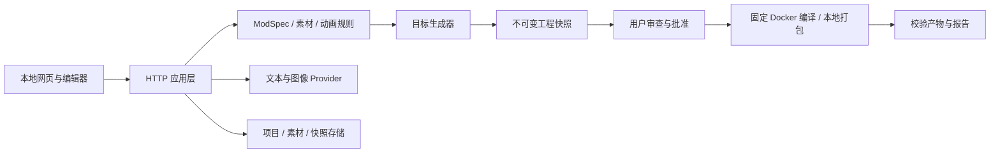

# 架构与设计原则 · 0.12

0.7 的自动创作应用层位于 `src/creation`，通过持久记录编排项目、素材、工程、构建和完整版本；生命周期见 ADR 0004。API 资料固定版本/官方来源，缓存在私有数据目录并验证哈希；模型只能输出受控 Java/JSON 文件修改，工程再次形成不可变快照后进入固定 runner。素材会话是独立领域，复用不可变素材存储和文本 provider，不依赖 HTTP 自调用。

采用**模块化单体**：一个本地 Node 进程提供 API 和网页，领域规则、存储、模型服务、目标生成器与构建器分层。无需额外数据库或前端打包服务，贡献者可定位单个行为；目标适配器避免将不同加载器的 API 混在同一个模板中。

## 模块责任

| 模块 | 责任与依赖方向 |
| --- | --- |
| `src/core` | 规格 schema/语义、目标、素材/动画、注册表、ZIP；不导入 HTTP/UI |
| `src/contracts` | 渐进式 TypeScript 适配器边界；不宣称全项目已经静态类型化 |
| `src/providers` | Chat Completions 与 Images 独立配置，约束输入/输出、取消/超时、脱敏 |
| `src/engineering/adapters` | Fabric、Forge/NeoForge、Bedrock；只接收已校验声明式数据 |
| `templates` | 各版本依赖锁、wrapper、来源与许可；生成器不查询任意模型代码 |
| `src/storage` | 项目/历史/会话、不可变素材、快照、迁移备份、单写者锁 |
| `src/runner` | 目标固定命令、镜像与执行限制；任务状态、日志、产物验证 |
| `src/server.mjs` 与 route 模块 | HTTP 边界、操作编排、Origin/Host、并发与确认 |
| `web/studio` | 像素/模型/实体/动画编辑；纯时间采样可单测，WebGL 由本地 Three.js 提供 |

生成器共享纯 Minecraft JSON/贴图输出；Fabric 与 Forge 系列 Java 注册代码分别维护。Bedrock 以标准行为/资源包表达，无法对应的能力明确拒绝。目标注册表提供 UI、校验、构建和报告共同使用的版本与能力，模板编译证据独立记录。

## 数据与一致性

数据目录包含 `projects/<uuid>.json`、`assets/<uuid>.json`、`workspaces/<project>/<hash>.json`、`builds/records`、`builds/artifacts`、`builds/runs` 和 `builds/cache`。用户名称不参与路径；读取拒绝符号链接/越界与损坏记录。

- 项目 revision 实现乐观并发；规格、20 版历史与最近 100 次会话在同一个原子 JSON 替换中提交。模型过期响应不能覆盖人工修改。
- 规范化必须幂等，规格与素材以 SHA-256 追踪；素材保存生成新 ID，避免影响旧工程。动画的再次校验也必须保持字节级规范表示。
- 工程由规格和素材生成不可变快照；确认绑定规格哈希，批准绑定工程哈希。编辑、恢复或导入清除批准，旧产物继续可下载。
- 完整备份先验证所有记录、哈希和引用，在临时目录准备后最后提交新项目；失败回滚本次新增文件。不是数据库级断电事务，崩溃可能留下无引用记录。
- 带进程身份的排他锁阻止双写者；只回收可证明为同机已退出进程的锁，不窃取来源不明锁。

JSON 存储适合当前单人本地使用。可选 Hub 在认证入口后为每个账号维护独立本地服务，并使用 SQLite 事务保存共享元数据；不能把本地进程直接公开部署。

## 执行与扩展

模型输出仅能形成经过 Ajv 与领域校验的规格/素材，没有任意 shell、宿主文件路径或动态依赖能力，受控 Java/JSON 修改在重新形成工程快照后编译。真实构建需要审查具体快照和选择联网；Java 固定受限 Docker runner，Bedrock 在本机纯数据打包。导入的外部源码不能直接进入 runner，必须经本机生成器重建。

构建状态独立于项目：`queued → running → passed / failed / cancelled / timed_out / interrupted`。成功只表示编译或包结构验证，可选服务端检查另行启动真实 GameTest，报告哈希关联版本，限定 `headless-server`；客户端验收保持 false。准备失败与代码/游戏失败分开，后者才进入有界模型修复，不自动改模板或无限重试。详细生命周期见 ADR 0005。

增加目标先实现注册表、独立模板/生成器、能力拒绝、契约回归与真实构建；增加 provider 先声明协议、输入范围、公开配置与取消/错误语义。不要为了插件形式动态执行不受信任第三方代码。

运行依赖与工具选择见 [开源评估](research/OPEN-SOURCE-REVIEW.md)；验证和发行流程见 [开发说明](DEVELOPMENT.md)。

## 网页服务配置 · 0.4

ProviderProfile 领域规则校验服务与协议参数；ProviderProfileStore 将最多 20 个配置、选中项和 revision 放入一个 0600 私有记录，原子提交。它与项目/素材分开，不参与项目备份。profile-runtime 只将明确白名单字段映射到既有 provider 工厂，不开放任意环境变量或逐次调用地址。

环境变量保留为启动时回退；网页启用项优先。设置写入期间复用单写者锁并检查乐观版本，运行中的文本/图像请求阻止设置修改。每次成功修改重建配置标识，使所有旧 consent 失效。前端重新获取公开元信息并取消勾选确认，不持久保存或回读密钥。

## 掉落资源生成 · 0.8

规格仅表达独立掉落条目，不接受原始游戏 JSON 或表达式。`src/engineering/loot.mjs` 负责共同默认语义及 Java/Bedrock 两种资源格式；目标适配器负责路径和引用。Forge/NeoForge 复用同游戏版本的资源生成，避免五份掉落逻辑漂移。编辑器通过稳定的对象 ID 选择目标，修改其他属性时显式保留 loot；规格事件清除过期条目编辑状态。旧规格不补默认字段，保持历史哈希兼容。

## 可选托管边界 · 0.10

`src/hub` 独立提供身份、会话、市场、积分和线路网关；共享 HTTP 传输位于 `src/http`。每账户子服务复用原有创作/编辑/构建内核并保持回环监听；认证网关去除外部凭据后转发。SQLite 保存余额、唯一账本引用、审核修订与令牌摘要，项目大文件仍按账号独立保存。默认本地模式不引入账号和计费依赖；生命周期、事务与运维限制见 ADR 0006 和 HOSTED.md。

## 层级模型 · 0.12

骨骼中间格式与共享校验位于 `src/core/skeleton.mjs`，文件/引擎交换位于 `skeleton-exchange.mjs`，旧格式兼容继续由 `animation.mjs` 统一管理。编辑器复用纯骨骼规则并在建图前拒绝环；模型预览器使用父子变换而非展平。素材工坊独立于项目，底层素材、会话、版本与备份继续复用既有领域。格式见 MODEL-FORMAT.md，设计取舍见 ADR 0007。
