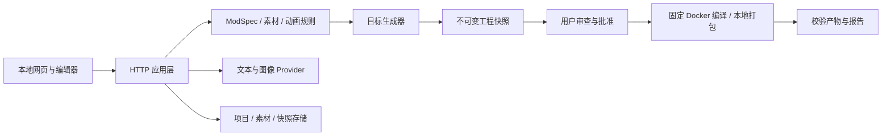

# 架构与设计原则 · 0.3

采用**模块化单体**：一个本地 Node 进程提供 API 和网页，领域规则、存储、模型服务、目标生成器与构建器分层。无需额外数据库或前端打包服务，贡献者可定位单个行为；目标适配器避免将不同加载器的 API 混在同一个模板中。

## 模块责任

| 模块 | 责任与依赖方向 |
| --- | --- |
| `src/core` | 规格 schema/语义、目标、素材/动画、注册表、ZIP；不导入 HTTP/UI |
| `src/contracts` | 渐进式 TypeScript 适配器边界；不宣称全项目已经静态类型化 |
| `src/providers` | Chat Completions 与 Images 独立配置，约束输入/输出、取消/超时、脱敏 |
| `src/engineering/adapters` | Fabric、Forge/NeoForge、Bedrock；只接收已校验声明式数据 |
| `templates` | 各版本依赖锁、wrapper、来源与许可；生成器不查询任意模型代码 |
| `src/storage` | 项目/历史/会话、不可变素材、快照、迁移备份、单写者锁 |
| `src/runner` | 目标固定命令、镜像与执行限制；任务状态、日志、产物验证 |
| `src/server.mjs` 与 route 模块 | HTTP 边界、操作编排、Origin/Host、并发与确认 |
| `web/studio` | 像素/模型/实体/动画编辑；纯时间采样可单测，WebGL 由本地 Three.js 提供 |

生成器共享纯 Minecraft JSON/贴图输出；Fabric 与 Forge 系列 Java 注册代码分别维护。Bedrock 以标准行为/资源包表达，无法对应的能力明确拒绝。目标注册表提供 UI、校验、构建和报告共同使用的版本与能力，模板编译证据独立记录。

## 数据与一致性

数据目录包含 `projects/<uuid>.json`、`assets/<uuid>.json`、`workspaces/<project>/<hash>.json`、`builds/records`、`builds/artifacts`、`builds/runs` 和 `builds/cache`。用户名称不参与路径；读取拒绝符号链接/越界与损坏记录。

- 项目 revision 实现乐观并发；规格、20 版历史与最近 100 次会话在同一个原子 JSON 替换中提交。模型过期响应不能覆盖人工修改。
- 规范化必须幂等，规格与素材以 SHA-256 追踪；素材保存生成新 ID，避免影响旧工程。动画的再次校验也必须保持字节级规范表示。
- 工程由规格和素材生成不可变快照；确认绑定规格哈希，批准绑定工程哈希。编辑、恢复或导入清除批准，旧产物继续可下载。
- 完整备份先验证所有记录、哈希和引用，在临时目录准备后最后提交新项目；失败回滚本次新增文件。不是数据库级断电事务，崩溃可能留下无引用记录。
- 带进程身份的排他锁阻止双写者；只回收可证明为同机已退出进程的锁，不窃取来源不明锁。

JSON 存储适合当前单人本地使用。未来多人服务或高频事件写入需另行引入事务数据库与认证；不能把本地进程直接公开部署。

## 执行与扩展

模型输出仅能形成经过 Ajv 与领域校验的规格/素材，没有任意 shell、文件路径或 Java 执行能力。真实构建需要审查具体快照和选择联网；Java 固定受限 Docker runner，Bedrock 在本机纯数据打包。导入的外部源码不能直接进入 runner，必须经本机生成器重建。

构建状态独立于项目：`queued → running → passed / failed / cancelled / timed_out / interrupted`。成功只表示编译或包结构验证，`gameTested` 单独保持 false，除非取得真实游戏证据。失败诊断生成修正规格建议，不自动改模板或无限重试。

增加目标先实现注册表、独立模板/生成器、能力拒绝、契约回归与真实构建；增加 provider 先声明协议、输入范围、公开配置与取消/错误语义。不要为了插件形式动态执行不受信任第三方代码。

运行依赖与工具选择见 [开源评估](research/OPEN-SOURCE-REVIEW.md)；验证和发行流程见 [开发说明](DEVELOPMENT.md)。
